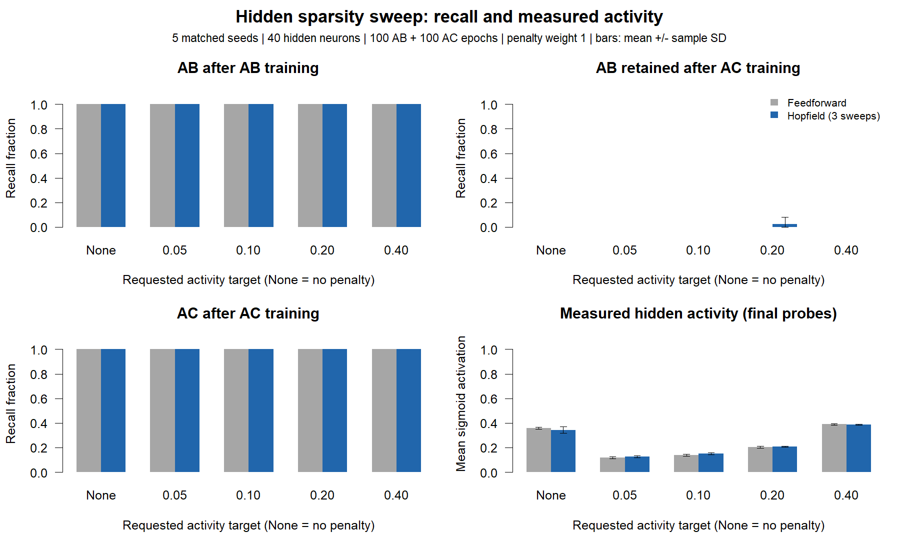

# Sparsity Attractor Network

A model of AB/AC paired-associate learning, with a continuous Hopfield network as the hidden layer of an autoencoder.

## Setup

The project declares Python 3.11 or newer. Python and dependencies are managed with `uv`. From the repository root:

```powershell
uv python install 3.11
uv sync --python 3.11
uv run python -m src.abac
```

The `just` shortcuts below are optional; each runs a Python module through `uv`.

## The network

The input and output layers are split into three parts:

- A, the cue item
- B/C, the associated item (B on the first list, C on the second)
- L, the list context (AB or AC)

The network learns to reproduce its input on its output. To test recall, it is given A and L with the B/C part blank, and it has to fill in B or C on the output.

By default, the input and output each have 50 units: 20 for A, 20 for B/C, and 10 for context. Each A, B, or C item has exactly 4 active units. The two contexts activate opposite halves of the context units. These input-pattern settings are defined by `Layout` in [src/patterns.py](src/patterns.py).

```text
input [A | B/C | L] --W--> hidden Hopfield network --W_out--> output [A | B/C | L]
                              recurrent W_R
```

The encoder supplies a drive `u = x @ W + b`. Hidden activations start at `sigmoid(u)`, then the Hopfield network updates one neuron at a time using `h[i] = sigmoid(u[i] + h @ W_R[:, i])`. The encoder's drive stays present throughout these updates. Each sweep visits every hidden neuron once; the decoder reads the hidden state after the requested number of sweeps.

`W_R` is symmetric with a zero diagonal, so there are no self-connections. Encoder, recurrent, and decoder weights learn together by backpropagation through the sweeps. This uses continuous sigmoid activations, following the [graded-response Hopfield model](https://pmc.ncbi.nlm.nih.gov/articles/PMC345226/), with a fixed sweep budget rather than a convergence test. It does not separately store patterns with a Hebbian learning rule.

Neurons are visited in index order on each sweep. The fixed sweep count bounds computation but does not guarantee that the state has reached equilibrium. Recurrent gradients are projected onto symmetric, zero-diagonal connections after backpropagating through the actual update sequence. Encoder and decoder weights are independent; the decoder is not constrained to be the encoder's transpose.

An optional k-winners-take-all readout applies **after** Hopfield settling and before decoding. `--sparsity` sets the fraction of hidden positions retained: `k = max(1, round(sparsity * n_hidden))`. The k largest activations keep their values and all other positions are set to zero. For example, `--hidden 40 --sparsity 0.1` retains 4 positions per pattern. The default, `--sparsity 1.0`, retains every position. The minimum is one retained position, including when the fraction is zero.

The recurrent updates themselves use the full continuous state. The hard readout gate is applied afterward, so the Hopfield energy-descent argument concerns the state before that gate. Training backpropagates through retained positions; non-winning positions receive no direct gradient through the gate, though they can still affect winners through recurrence. With zero recurrent sweeps, this reproduces the feedforward k-winner model.

## Running

| Command | Purpose |
| --- | --- |
| `just` | List common commands. |
| `just run` | Train AB, then AC, and print recall. |
| `just plot` | Also save the recall curve to `figures/abac.png`. |
| `just pure` | Train on complete patterns only, without blank-slot probes. |
| `just task` | Print the generated patterns. |
| `just sweep` | Compare hidden activity targets across seeds and models. |
| `just test` | Run the numerical and experiment checks. |

The hidden layer uses 3 recurrent sweeps by default. For example, `just run --hopfield-steps 5` uses 5 sweeps, and `just run --hopfield-steps 0` reproduces the original feedforward autoencoder. `--hidden` still controls the number of hidden neurons. `--no-probes` controls training examples and works with either setting.

Run the numerical gradient and model checks with `uv run python -m unittest discover -s tests`.

`just run` first trains on all the AB pairs for 100 epochs, then on all the AC pairs for 100 epochs. After each epoch it tests every pair on both lists. The AB and AC columns show the fraction of pairs recalled correctly. With 8 pairs, 2 correct is 2/8 = 0.25.

The AB-to-AC switch measures catastrophic interference: whether learning AC causes the network to forget AB. Recurrent connections alone do not guarantee that the model retains both lists.

Recall compares the reconstructed B/C slot with every B and C candidate by squared distance. A wrong-list response counts as an error. Both lists are tested after every epoch. High AB recall before the switch and high AC recall afterward show that each list can be learned; preserving AB **after AC training** is the test of resistance to interference. These are trained associations, so this experiment does not measure generalization to held-out pairs. The printed values are recall fractions, not reconstruction losses.

## Hidden sparsity experiments

Hidden sparsity is controlled separately from the sparse A/B/C input patterns. Set `--hidden-target` to a soft target for the mean activation across hidden neurons **within each pattern**, after Hopfield settling. For example:

```powershell
uv run python -m src.abac --hidden-target 0.1 --sparsity-weight 1
uv run python -m src.sweep
uv run python -m src.sweep --targets none 0.05 0.1 0.2 0.4 --seeds 0 1 2 3 4 --plot figures/hidden_sparsity.png
```

The training objective adds `sparsity_weight * n_hidden / 2 * (mean(h) - hidden_target)^2` to reconstruction cross-entropy, where `h` is the code passed to the decoder after any k-winner gate. The target encourages a level of activity; it does not enforce an exact number of active neurons. Omitting the target, or setting its weight to zero, preserves the reconstruction objective. The penalty is applied during training; inference uses the learned weights, Hopfield dynamics, and optional k-winner gate.

`--sparsity` and `--hidden-target` are separate controls: the first retains a fixed number of positions, and the second encourages a mean activation. They can be combined, but the hard gate limits the achievable mean activity to at most `k / n_hidden` because all other positions are zero.

The default sweep compares no penalty and targets of 0.05, 0.1, 0.2, and 0.4, using seeds 0–4. It tests both the feedforward control (0 recurrent sweeps) and the Hopfield model (3 sweeps), keeping hidden width, input patterns, initialization, and training order matched within each seed. Use `--hopfield-steps 3` to test only the Hopfield model. Both training phases use 100 epochs, as in the main experiment; the same epoch, hidden-width, pair-count, learning-rate, and probe-training options are available.

Raw results go to `figures/hidden_sparsity.csv`, and means plus sample standard deviations across seeds go to `figures/hidden_sparsity_summary.csv`. Use `--output` to choose another location. Each result includes AB recall after AB, AB and AC recall after AC, signed AB forgetting (AB before AC minus AB after AC), and measured hidden activity on both lists' final recall probes. Both mean sigmoid activation and the fraction of activations above 0.5 are recorded, so low mean activity can be distinguished from fewer strongly active neurons. The optional plot shows mean ± sample standard deviation across seeds.

Every configuration starts with a fresh network. Completed raw rows are flushed to disk as runs finish; the summary is written after the sweep completes. Changing `--output` changes the summary's location and stem as well.

### Options and controls

| Option | Default | Meaning |
| --- | --- | --- |
| `--pairs` | `8` | Number of associations per list. |
| `--hidden` | `40` | Number of hidden neurons; independent of activity sparsity. |
| `--sparsity` | `1.0` | Fraction of hidden positions retained by k-winners-take-all after settling; between 0 and 1, with at least one retained position. |
| `--lr` | `0.2` | Learning rate for all trainable connections. |
| `--epochs-ab`, `--epochs-ac` | `100` each | Training epochs per phase. |
| `--hopfield-steps` | `3` for `src.abac`; `0 3` for `src.sweep` | Recurrent sweeps; zero is the feedforward control. The sweep accepts multiple values. |
| `--hidden-target` | Unset | Single-run mean-activity target, from 0 to 1. |
| `--targets` | `none 0.05 0.1 0.2 0.4` | Activity settings for `src.sweep`; `none` disables the penalty. |
| `--sparsity-weight` | `1.0` | Nonnegative weight on the activity penalty. |
| `--seed` / `--seeds` | `0` / `0 1 2 3 4` | One seed for `src.abac`, or several for `src.sweep`. |
| `--no-probes` | Off | Train on complete patterns only; recall still uses blank-slot probes. |
| `--every` | `10` | Print every Nth epoch, plus the first, in `src.abac`. |
| `--plot` | Unset | Optional output image path. |
| `--output` | `figures/hidden_sparsity.csv` | Raw CSV path for `src.sweep`. |

`just pure` changes training examples; use `--hopfield-steps 0` to disable recurrence. For a feedforward soft-activity control, run `just run --hopfield-steps 0 --hidden-target 0.1`. Increasing `--sparsity-weight` gives the activity target more influence relative to reconstruction.

For a hard k-winner experiment, run `just run --sparsity 0.1`. The sweep also accepts one fixed `--sparsity` value, for example `just sweep --sparsity 0.1 --hopfield-steps 3`. Its `--targets` grid varies the soft activity target while keeping the k-winner fraction fixed.

For a small command-line smoke run:

```powershell
uv run python -m src.sweep --targets none 0.1 --seeds 0 --hidden 8 --epochs-ab 2 --epochs-ac 2 --output figures/smoke.csv
```

Use `uv run python -m src.abac --help` or `uv run python -m src.sweep --help` for command-specific options.

### Reading the output

| Raw metric | Meaning |
| --- | --- |
| `ab_after_ab` | AB recall at the end of AB training. |
| `ab_after_ac` | AB recall retained at the end of AC training. |
| `ac_after_ac` | AC recall at the end of AC training. |
| `ab_forgetting` | `ab_after_ab - ab_after_ac`; larger positive values mean more forgetting. |
| `mean_hidden` | Mean hidden activation after the optional k-winner gate, over neurons and final recall probes from both lists. |
| `fraction_above_half` | Fraction of those activations strictly above 0.5. This is a diagnostic threshold, not a training constraint. |

Raw rows also record the seed and training settings. Summary columns end in `_mean` or `_sd`; `_sd` is sample standard deviation across seeds, not standard error or a confidence interval. With one seed, the reported deviation is zero. A target of 0.05 does not enforce exactly 5% active neurons, so use the measured activity columns when comparing representations.

New raw outputs also record `sparsity` and `k_active`, the requested hard fraction and resulting number of retained positions.

### Initial 50-run results

The recorded sweep used 8 pairs, 40 hidden neurons, learning rate 0.2, 100 AB epochs followed by 100 AC epochs, probe training enabled, sparsity weight 1, seeds 0 through 4, and 0 or 3 recurrent sweeps. The hard fraction was 1.0, so every hidden position was retained. The following command reproduces those settings and creates a plot:

```powershell
uv run python -m src.sweep --plot figures/hidden_sparsity.png
```

Every run reached 100% AB recall before AC training and 100% AC recall afterward. The Hopfield results below are means across five seeds:

| Requested activity target | Measured mean hidden activity | AB recall after AC |
| --- | --- | --- |
| No penalty | 0.343 | 0% |
| 0.05 | 0.128 | 0% |
| 0.10 | 0.150 | 0% |
| 0.20 | 0.209 | 2.5% |
| 0.40 | 0.388 | 0% |

The 2.5% mean represents one correctly retained AB pair in one seed out of five. Every feedforward setting retained 0% AB recall after AC. The penalty changed hidden activity, but this sweep did not show substantial protection against interference. These findings apply to this soft activity penalty and training regime; they do not establish what a hard k-active constraint would do.

[Raw runs](results/hidden_sparsity.csv) | [Summary statistics](results/hidden_sparsity_summary.csv)



The recorded runs used a locally available Python 3.10.12 and NumPy 1.23.5 fallback. Validation under the project's declared Python 3.11+ remains outstanding. The recorded chart was rendered with R 4.3.1; the Python `--plot` command uses Matplotlib. Generated files in `figures/` are ignored by Git; the files in `results/` preserve this particular experiment.

## Functions and programmatic use

| Module | Main functions and classes |
| --- | --- |
| [src/patterns.py](src/patterns.py) | `Layout` defines input sections; `make_task()` creates paired lists; `Task.full()` and `Task.probe()` provide complete patterns and recall cues. |
| [src/autoencoder.py](src/autoencoder.py) | `Autoencoder.encode()` returns external drive, `hidden_state()` settles the state and applies the optional k-winner gate, `decode()` reconstructs from that code, `forward()` runs the complete model, `activity_penalty()` returns activity loss and its gradient, and `train_step()` updates all trainable connections. |
| [src/hopfield.py](src/hopfield.py) | `Hopfield.forward()` runs recurrent sweeps for a vector or batch; `return_cache=True` also returns the update history. `backward()` uses that cache to return drive and constrained recurrent gradients. |
| [src/sparsity.py](src/sparsity.py) | `n_active()` converts the hard fraction to a retained count. `k_winners_take_all()` masks all other activations; `return_mask=True` also provides the mask for backpropagation. |
| [src/abac.py](src/abac.py) | `train_epoch()` trains one shuffled pass, `recall()` scores a list, and `run()` returns the trained model, task, and epoch history. `print_history()` and `plot_history()` display that history. |
| [src/sweep.py](src/sweep.py) | `sweep()` yields one result dictionary per setting and seed. `summarize()` computes grouped means and sample standard deviations. |
| [src/sweep_plot.py](src/sweep_plot.py) | `plot_summary()` saves the four-panel comparison from a sweep summary. |

For example, inspect a trained network's hidden state and recall:

```python
from src.abac import recall, run

net, task, history = run(
    n_pairs=8, n_hidden=40, hopfield_steps=3,
    hidden_target=0.1, sparsity_weight=1.0, seed=0,
)

probes = task.probe("AB")                  # Shape: (8, 50).
drive = net.encode(probes)                  # Shape: (8, 40); before sigmoid.
hidden = net.hidden_state(probes)          # Settled, optionally gated code, shape (8, 40).
output = net.decode(hidden)                 # Same computation as net.forward(probes).
print("AB retained:", recall(net, task, "AB"))
print("AC learned:", recall(net, task, "AC"))
print("Mean hidden activity:", hidden.mean())
```

`history` contains `(phase, AB_recall, AC_recall)` for every epoch. `train_step()` accepts one input/target pair; forward evaluation also accepts batches. The main weights are `net.W`, `net.W_out`, and `net.hopfield.W_R`, with biases in `net.b` and `net.b_out`. Direct edits to `W_R` must preserve symmetry and a zero diagonal for the Hopfield energy argument to apply.

## Checks

```powershell
uv run python -m unittest discover -s tests -v
```

The automated checks cover numerical gradients through encoder, decoder, recurrence, the k-winner gate, and the activity penalty; energy descent during asynchronous updates; finite activations for extreme inputs; vector/batch agreement; equivalence to the dense and k-winner feedforward models with recurrence disabled; retained-position counts and sparsity validation; reduced activity under a low target; matched zero-penalty controls; summary statistics; and CSV output from a small command-line sweep. All 20 current checks passed with the Python 3.10 fallback described above.
